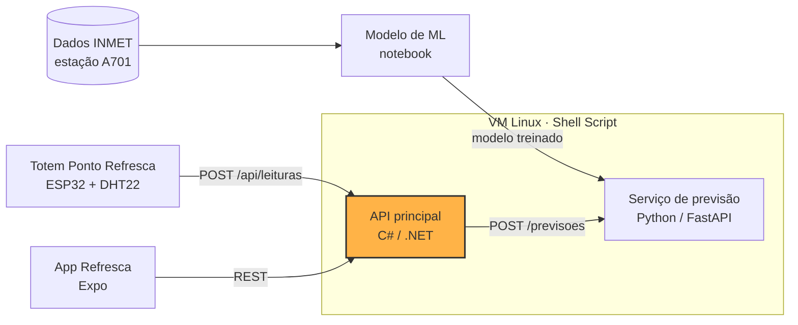
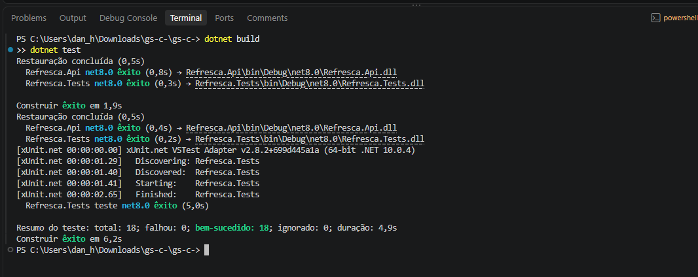
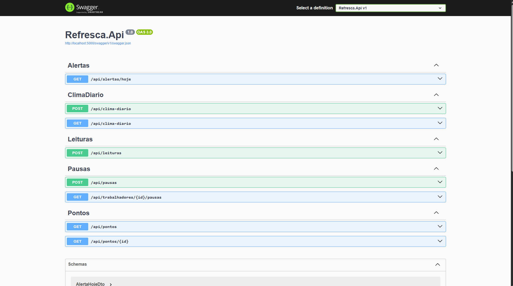
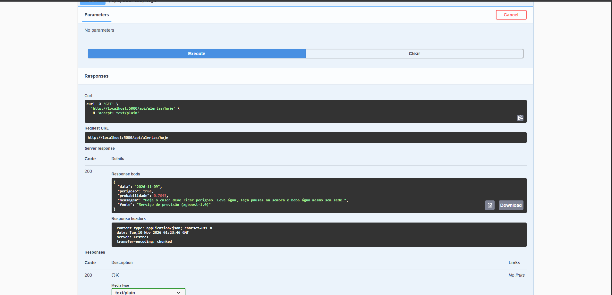
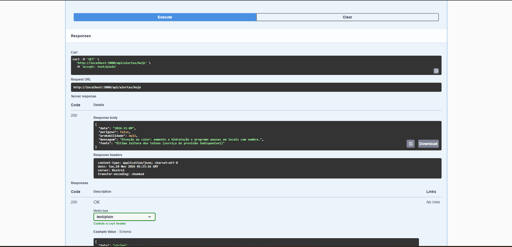
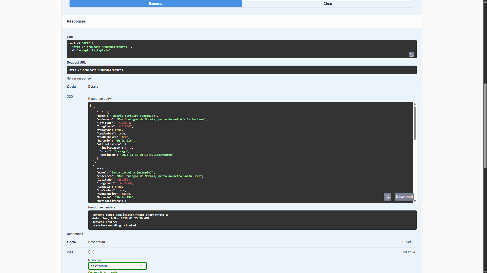
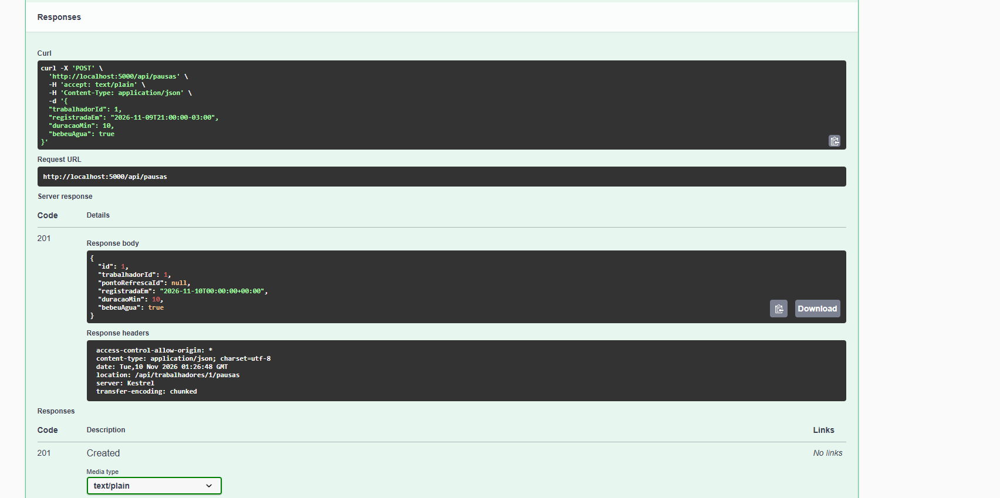
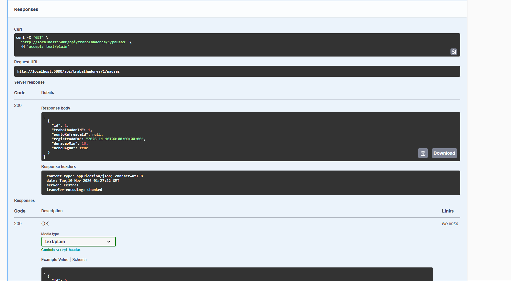

# Refresca · API Principal em C#

> Parte da CitizenTech **Refresca**, da Global Solution 2026.2 (FIAP, Engenharia de Software, 3º ano de Fev).
> Alertas de calor extremo e pontos de água e sombra para trabalhadores de rua da Vila Mariana.

**Disciplina:** C# Software Development

## Ficha da CitizenTech

| Campo | Conteúdo |
| --- | --- |
| **Nome** | Refresca |
| **Cidade e bairro** | São Paulo, Vila Mariana |
| **Cidadão beneficiado** | Trabalhador de rua: ambulante, entregador, gari, vendedor de banca |
| **Problema, em uma frase** | Trabalhadores de rua da Vila Mariana passam o dia expostos ao sol sem saber quando o calor fica perigoso, nem onde encontrar sombra e água por perto. |
| **Como funciona** | 1. Totens "Ponto Refresca" em comércios parceiros medem o índice de calor na rua e mostram um alerta colorido para quem passa. 2. Um modelo treinado com dados do INMET prevê se amanhã será um dia de calor perigoso. 3. O app avisa o trabalhador na véspera, mostra os pontos com água, sombra e banheiro mais próximos e lembra das pausas para hidratação. |
| **O que cada parte faz** | Ver [Repositórios da Refresca](#repositórios-da-refresca) |
| **Link do repositório** | https://github.com/danilowendler/gs-c- |
| **Indicador de impacto** | Pausas de hidratação registradas no app em dias de alerta; % de alertas enviados antes do pico de calor; recall do modelo nos dias perigosos |
| **ODS conectados** | 3, 8, 10, 11 e 13 (detalhes abaixo) |

### Persona (fictícia)

Persona criada pela equipe a partir de informações públicas sobre trabalho de rua e calor. Não representa uma pessoa real nem uma entrevista realizada.

**Marcos, 34 anos, entregador de moto por aplicativo na Vila Mariana.** Passa cerca de 10 horas por dia na rua, esperando pedidos na calçada. Nos dias mais quentes sente dor de cabeça e tontura no fim da tarde. Compra água no comércio ou fica sem, quase não para porque perde corridas e tem pouco dado no celular pré-pago.

### Como os ODS são atendidos

- **ODS 3 · Saúde e bem-estar:** reduz o risco de exaustão e insolação ao antecipar dias perigosos e incentivar pausas e hidratação.
- **ODS 8 · Trabalho decente:** melhora as condições de trabalho de quem não tem posto fixo nem empregador que ofereça estrutura.
- **ODS 10 · Redução das desigualdades:** chega a quem tem pouco acesso a dados móveis, já que o totem funciona sem celular.
- **ODS 11 · Cidades sustentáveis:** transforma comércios do bairro em uma rede de pontos de apoio no espaço público.
- **ODS 13 · Ação contra a mudança do clima:** é uma ferramenta de adaptação a ondas de calor.

## Esta parte da Refresca

Esta aplicação backend desenvolvida em C# e ASP.NET Core atua como o coração da infraestrutura de dados do Refresca. Ela é responsável por receber e consolidar as leituras de índice de calor transmitidas pelos totens, expor os pontos de hidratação e sombra cadastrados no bairro para o aplicativo mobile e armazenar o histórico de pausas ativas registradas pelos trabalhadores.

**Recebe dados de:** Totem Ponto Refresca (leituras de temperatura e umidade), resumo diário do clima (`POST /api/clima-diario`) e Serviço de Previsão em Python (probabilidade de calor perigoso calculada pelo modelo de ML).
**Envia dados para:** App Mobile (alerta do dia, pontos com a última leitura de cada totem e histórico de pausas) e Serviço de Previsão (resumo dos 3 dias anteriores, no `POST /previsoes`).

## Arquitetura



## Repositórios da Refresca

| Parte | Disciplina | Repositório | Responsável |
| --- | --- | --- | --- |
| Totem (Wokwi) | Physical Computing: IOT & IOB | [link do Wokwi] | [Nome] |
| API principal | C# Software Development | https://github.com/danilowendler/gs-c- | Italo Caliari Silva |
| Serviço de previsão | SOA e Web Services | https://github.com/danilowendler/gs-soa | Italo Caliari Silva |
| Modelo de ML | Inteligência Artificial & Machine Learning | [link] | Danilo Gronski Wendler |
| App | Mobile Development & IOT | https://github.com/danilowendler/Global-Solution-Refresca---Mobile | Danilo Gronski Wendler |
| Infraestrutura Linux | Operating Systems | [link] | [Nome] |
| Segurança e PII | Cybersecurity | entregue em ZIP | [Nome] |
| Features e testes | Testing, Compliance & QA | [link do Azure Boards] | [Nome] |

## Contratos entre as partes

| Serviço | URL local padrão | Variável de configuração |
| --- | --- | --- |
| API principal (C#) | `http://localhost:5000` | `REFRESCA_API_URL` |
| Serviço de previsão | `http://localhost:8000` | `REFRESCA_PREVISAO_URL` |

**Níveis do índice de calor** (faixas da NOAA, usadas pelo totem, pela API e pelo app):

| Nível | Índice de calor | Cor no totem |
| --- | --- | --- |
| `normal` | abaixo de 27 °C | verde |
| `atencao` | de 27 °C até abaixo de 32 °C | amarelo |
| `perigo` | a partir de 32 °C | vermelho |

### Totem → API: `POST /api/leituras`

```json
{
  "totemId": "TOT-001",
  "temperatura": 33.4,
  "umidade": 48.0,
  "indiceCalor": 35.1,
  "nivel": "perigo",
  "medidoEm": "2026-11-19T14:00:00-03:00"
}
```

### App → API

| Método | Rota | Uso no app |
| --- | --- | --- |
| `GET` | `/api/alertas/hoje` | Alerta do dia na tela inicial |
| `GET` | `/api/pontos` | Mapa de Pontos Refresca, com a última leitura de cada totem |
| `GET` | `/api/pontos/{id}` | Detalhe de um ponto |
| `POST` | `/api/pausas` | Registrar pausa de hidratação |
| `GET` | `/api/trabalhadores/{id}/pausas` | Histórico de pausas |

Resposta de `GET /api/alertas/hoje`:

```json
{
  "data": "2026-11-19",
  "perigoso": true,
  "probabilidade": 0.82,
  "mensagem": "Hoje o calor deve ficar perigoso à tarde. Leve água e programe pausas na sombra."
}
```

Exemplo de ponto em `GET /api/pontos` (a rota devolve uma lista destes; `ultimaLeitura` pode ser `null`):

```json
{
  "id": 1,
  "nome": "Padaria Exemplo",
  "endereco": "Rua Domingos de Morais, perto do metrô Vila Mariana",
  "latitude": -23.5890,
  "longitude": -46.6340,
  "temAgua": true,
  "temSombra": true,
  "temBanheiro": false,
  "horario": "6h às 21h",
  "ultimaLeitura": { "indiceCalor": 35.1, "nivel": "perigo", "medidoEm": "2026-11-19T14:00:00-03:00" }
}
```

Corpo de `POST /api/pausas`:

```json
{
  "trabalhadorId": 1,
  "registradaEm": "2026-11-19T14:30:00.000Z",
  "duracaoMin": 10,
  "bebeuAgua": true
}
```

### API → Serviço de previsão: `POST /previsoes`

Requisição (resumo diário de anteontem, ontem e hoje; a previsão é para amanhã):

```json
{
  "dataPrevista": "2026-11-20",
  "dias": [
    { "dia": "2026-11-17", "tempMax": 30.1, "tempMin": 18.2, "tempMedia": 23.5, "umidMedia": 62.0, "umidMin": 38.0, "indiceCalorMax": 30.8, "pressaoMedia": 924.6, "radiacaoTotal": 21500, "precipTotal": 0.0, "ventoMedio": 2.0 },
    { "dia": "2026-11-18", "tempMax": 31.8, "tempMin": 19.0, "tempMedia": 24.6, "umidMedia": 58.0, "umidMin": 35.0, "indiceCalorMax": 32.4, "pressaoMedia": 923.9, "radiacaoTotal": 23100, "precipTotal": 0.0, "ventoMedio": 1.8 },
    { "dia": "2026-11-19", "tempMax": 33.0, "tempMin": 19.8, "tempMedia": 25.4, "umidMedia": 55.0, "umidMin": 31.0, "indiceCalorMax": 33.9, "pressaoMedia": 923.1, "radiacaoTotal": 24000, "precipTotal": 0.0, "ventoMedio": 2.1 }
  ]
}
```

O serviço transforma esses 3 dias nas variáveis do modelo com o módulo `ml/preparar_variaveis.py` do repositório de ML, que reproduz exatamente o cálculo do notebook.

Resposta:

```json
{
  "id": 42,
  "dataPrevista": "2026-11-20",
  "probabilidade": 0.82,
  "perigoso": true,
  "versaoModelo": "1.0"
}
```

### Rotas extras desta API

| Método | Rota | O que faz |
| --- | --- | --- |
| `POST` | `/api/leituras` | Recebe a leitura de um totem (`201`); o nível precisa bater com o índice de calor |
| `POST` | `/api/clima-diario` | Registra ou atualiza o resumo do clima de um dia (vindo da estação do INMET) |
| `GET` | `/api/clima-diario?dias=7` | Últimos dias registrados |

### Como o alerta do dia é calculado

1. A API pega o resumo do clima dos **3 dias anteriores a hoje** (tabela `ClimasDiarios`).
2. Envia para o serviço de previsão (`POST /previsoes`), que roda o modelo XGBoost treinado com dados do INMET e devolve a probabilidade de calor perigoso.
3. Se o serviço de previsão estiver fora do ar, ou faltar algum dos 3 dias, o alerta vem da **última leitura dos totens**, e o campo `fonte` avisa isso. O app continua funcionando nos dois casos.

## Tecnologias

- C# 12 e .NET 8 (ASP.NET Core Web API)
- Entity Framework Core 8 com SQLite e LINQ
- Injeção de dependência, Repository e Unit of Work
- `HttpClient` tipado para o serviço de previsão (`IPrevisaoClient`)
- `TimeProvider` para tornar a data de "hoje" testável
- Swashbuckle (Swagger/OpenAPI)
- xUnit e EF Core InMemory (testes)

## Organização do código

```
Refresca.Api/
├── Controllers/                 Rotas REST (alertas, pontos, pausas, leituras, clima diário)
├── Application/DTOs/            Contratos JSON (records e classes com validação)
├── Application/Interfaces/      IRefrescaService, IRepository<T>, IUnitOfWork, IPrevisaoClient
├── Domain/Entities/             Leitura, PontoRefresca, PausaHidratacao, ClimaDiario (com regras de validação)
├── Infrastructure/Persistence/  DbContext, dados iniciais simulados e relógio de São Paulo
├── Infrastructure/Repositories/ Repository<T> genérico e Unit of Work
├── Infrastructure/Services/     RefrescaService (casos de uso)
├── Infrastructure/Clients/      PrevisaoClient (chamada HTTP ao serviço de previsão)
└── Infrastructure/Middleware/   Tratamento de erros (400, 404, 500 em JSON)
Refresca.Tests/                  Testes de domínio e do serviço (banco em memória e previsão falsa)
```

### Por que as datas usam um conversor no banco

O SQLite não tem tipo próprio para `DateTimeOffset`, e o EF Core não consegue traduzir `ORDER BY` nem comparações com ele, o que derruba com erro qualquer consulta "da leitura mais recente". Por isso `MedidoEm` e `RegistradaEm` são gravados como número com o `DateTimeOffsetToBinaryConverter`, sempre em UTC para a ordem ficar correta.

## Como rodar

### Pré-requisitos

- .NET 8 SDK ou mais recente. Os projetos usam `RollForward=Major`, então também rodam em máquinas que só têm o .NET 9 ou o .NET 10 instalado.
- Opcional: o serviço de previsão rodando em `http://localhost:8000` (repositório de SOA). Sem ele, o alerta vem dos totens.

### Passos

```bash
git clone https://github.com/danilowendler/gs-c-.git
cd gs-c-
dotnet restore
dotnet build
dotnet test
dotnet run --project Refresca.Api
```

A API sobe em `http://0.0.0.0:5000`, ou seja, aceita conexões de outros aparelhos da mesma rede, como o celular com o app. Na primeira vez, o Windows pode pedir para liberar o acesso no firewall: permita em redes privadas.

O banco `refresca.db` é criado na primeira execução, já com 5 Pontos Refresca, leituras dos totens e o clima dos 3 últimos dias, todos **simulados**. Se você já tinha rodado uma versão anterior, **apague o `refresca.db`** antes, porque o banco é criado com `EnsureCreated` e não recebe colunas novas.

### Configuração

| Configuração | Padrão | Para quê |
| --- | --- | --- |
| `Urls` (appsettings) | `http://0.0.0.0:5000` | Endereço e porta da API |
| `ConnectionStrings:Refresca` | `Data Source=refresca.db` | Banco SQLite |
| `REFRESCA_PREVISAO_URL` (variável de ambiente) ou `Servicos:PrevisaoUrl` (appsettings) | `http://localhost:8000` | Endereço do serviço de previsão |

### Conectar o app

No `.env` do app, use o IP do computador na rede Wi-Fi, não `localhost` (no celular, `localhost` é o próprio celular):

```
EXPO_PUBLIC_API_URL=http://192.168.0.10:5000
```

## Documentação dos endpoints

Com a API rodando: **http://localhost:5000/swagger**

## Testes

```bash
dotnet test
```

Cobrem as faixas do índice de calor, validações das entidades, o alerta do dia usando o serviço de previsão (com uma previsão falsa) e caindo para os totens quando ele está fora do ar, o formato dos pontos esperado pelo app, a ordem do histórico de pausas e a atualização do clima diário.

## Evidências

Prints da API rodando localmente, em [`docs/evidencias/`](docs/evidencias/).

### 1. Testes automatizados

`dotnet test` com os 18 testes passando.



### 2. Documentação no Swagger

Todos os endpoints da API em `http://localhost:5000/swagger`.



### 3. Alerta do dia com o serviço de previsão no ar

`GET /api/alertas/hoje` consultando o serviço de previsão (SOA), que usa o modelo treinado com dados do INMET. A resposta traz `perigoso`, a `probabilidade` calculada pelo modelo e `fonte` indicando a previsão.



### 4. Alerta do dia sem o serviço de previsão

O mesmo endpoint com o serviço de previsão desligado. A API não quebra: calcula o alerta pelas leituras dos totens e informa essa `fonte`.



### 5. Pontos Refresca

`GET /api/pontos` devolvendo os pontos com endereço e horário, no formato usado pelo app.



### 6. Registro de pausa

`POST /api/pausas` respondendo `201 Created` com a pausa salva. O horário é guardado em UTC.



### 7. Histórico de pausas

`GET /api/trabalhadores/1/pausas` listando a pausa registrada no passo anterior.



## Entregáveis da disciplina

- [x] POO: entidades com encapsulamento e validação, records, interfaces (3,0)
- [x] Web API com endpoints REST e status corretos (2,5)
- [x] EF Core + LINQ (1,5)
- [x] Async/await em toda a cadeia, inclusive a chamada HTTP (1,0)
- [x] Qualidade do código: camadas, injeção de dependência, tratamento de erros, testes (2,0)
- [x] Documentação dos endpoints (Swagger)
- [x] Evidências da aplicação em `docs/evidencias/`

## Dados

- **Pontos Refresca, leituras e clima diário iniciais:** dados simulados, criados pela equipe. Os estabelecimentos são fictícios; os endereços são ruas reais da Vila Mariana, com coordenadas aproximadas.
- **Previsão:** vem do serviço de previsão, com o modelo treinado com dados históricos horários do INMET, estação A701 (São Paulo, Mirante de Santana), https://portal.inmet.gov.br/dadoshistoricos
- Nenhum dado pessoal real é usado no projeto.

## Uso de IA

A IA foi usada como copiloto para aprender e revisar. Os prompts estão registrados em [`prompts.md`](prompts.md).

## Integrantes

| Nome | RM |
| --- | --- |
| Danilo Gronski Wendler | RM556602 |
| Italo Caliari Silva | RM554758 |
| Júlio César Ruiz Zequin | RM554676 |
| Pedro Henrique Muzel Santos | RM555983 |
| Vitor Montemor Ismael | RM556027 |
